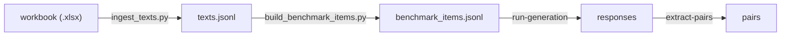

# Reading Comprehension Question Generation Benchmark (rcqg)

A benchmark that gives a model a short reading passage and asks it to write
question-and-answer pairs about it. This package covers the generation side: reading the
passages, running the models, and pulling the pairs out of their responses.

**Not built yet: the judge.** Scoring the pairs with an LLM judge and an expert rubric
is a later piece of work, because the rubric is still being developed. Nothing here
scores, ranks, or filters pairs.

It reuses the `phonics_benchmark` run harness (config, checkpointed runner, caching, GCS
sync), as `decodable_text_generation` does. See the phonics README for the shared run
and config behaviour. What is specific to this package is the data pipeline, the prompt,
and the pair extraction.

## Pipeline

Four commands, run from this folder
(`benchmarks/reading_comprehension_question_generation`):



1. **Ingest** one language's workbook into text records:

   ```bash
   uv run python scripts/ingest_texts.py --language english \
       --workbook data/english/raw/<your workbook>.xlsx
   ```

1. **Build items** from the text records:

   ```bash
   uv run python scripts/build_benchmark_items.py --language english
   ```

1. **Run** the models:

   ```bash
   uv run rcqg run-generation --language english --models <model-name> \
       --run-id my-run --output-dir outputs --env-path ../../.env
   ```

1. **Extract** the Q&A pairs from the raw responses:

   ```bash
   uv run rcqg extract-pairs --run-id my-run --output-dir outputs
   ```

`rcqg` is a short name for `reading-comprehension-question-generation`; both work.

## Data

Data is kept per language, one workbook per language. Four workbook fields drive the
pipeline (`text_id`, `text_content`, `language_iso_code`, and `grade`); the rest are
descriptive. See [data/README.md](data/README.md) for the fields.

```text
data/<language>/
├── raw/<workbook>.xlsx       the filled-in workbook (not in git)
├── templates/                the blank-format data-entry workbook
├── texts.jsonl               one record per text, 15 fields (not in git)
└── benchmark_items.jsonl     one item per text, 4 fields (not in git)
```

**Nothing under `data/` is committed except `data/README.md` and the workbook in
`templates/`**, and run outputs are ignored too. Passages are not published from this
repository.

## The prompt and the fixed pair count

The prompt template is `question_generation` in
`src/reading_comprehension_question_generation/prompts.yaml`. It is rendered at run time
from only the passage, the language name, and the grade, and the rendered prompt is
saved in every result row. Editing the template changes the prompt and so the cache
identity: earlier cached responses are not reused for the new prompt. Use
`--prompt-name` to pick another template key.

The prompt opens with a short context paragraph (a teacher checking whether early
primary learners understand what they read), then one sentence that states the passage's
language and grade and asks for the questions and answers to be written in that
language, then the output format. It asks for **exactly 3** pairs, returned as a JSON
array of objects with `question` and `answer` keys. Three is a single constant
(`NUM_PAIRS` in `prompts.py`). It is not configurable per run or per text, and no config
key or option sets it. Extraction compares each response against the same constant.
Making the count configurable per text is a decision to revisit.

## Running

Run from a config file or from command-line options. `configs/example.json` is a
starting point; its `models` entry is a placeholder.

```bash
uv run rcqg run-generation --config configs/example.json
```

The options match `decodable_text_generation`: `--run-id`, `--timestamped-output`,
`--models` (comma-separated or a JSON array) or repeated `--model`, `--output-dir`,
`--items-path`, `--custom-models-path`, `--skip-models-download`, `--env-path`,
`--prompt-name`, `--max-tokens`, `--chunk-size`, `--model-workers`, `--force`,
`--retry-errors`, and `--results-dest`. `upload-results` and `fetch-results` are the
phonics ones, unchanged.

- `--items-path` defaults to `data/<language>/benchmark_items.jsonl` in this folder.
- Responses are cached, so rerunning a finished run does nothing. Use `--force` to rerun
  everything or `--retry-errors` to rerun only failed calls.
- Set `--max-tokens` (the example uses 30000) so reasoning models do not run out of room
  before they answer.
- Before a run the CLI downloads the latest shared `custom_models.yaml` unless you pass
  `--skip-models-download`; then it uses the file at `--custom-models-path` (the shared
  repo-root file by default).

### Results layout

```text
<output-dir>/<run-id>/
├── config.json               resolved config, items hash, per-model settings
├── log.json
└── responses/responses_<model>.jsonl     one row per text, with the raw output
```

## Extracting pairs

`extract-pairs` reads a run's raw responses and writes three files into the run folder
(reruns overwrite them). It takes `--run-id` with `--output-dir`, or `--run-dir`.

| File                      | Contents                                                                                     |
| ------------------------- | -------------------------------------------------------------------------------------------- |
| `pairs.jsonl`             | one row per extracted pair: model, `text_id`, `pair_index`, `question`, `answer`, status     |
| `response_status.jsonl`   | one row per response: `call_status`, `parse_status`, requested and extracted pair counts     |
| `extraction_summary.json` | per model: responses, total pairs, counts by status, and whether the items file is unchanged |

The parser takes the last JSON array in the response that holds at least one valid pair.
It skips code fences, preamble, and trailing text, and removes `<think>` blocks. A valid
pair is an object with non-empty string `question` and `answer`. Each response gets one
status:

| `parse_status`   | Meaning                                                                    |
| ---------------- | -------------------------------------------------------------------------- |
| `ok`             | exactly 3 valid pairs                                                      |
| `count_mismatch` | a different number of valid pairs; the pairs are kept and flagged, not cut |
| `no_pairs`       | an array was found but none of its elements is a valid pair                |
| `parse_failed`   | no JSON array could be read (including an empty response)                  |
| `call_error`     | the model call failed, so there was nothing to parse                       |

Parse problems are reported, not fatal: `extract-pairs` prints per-model counts and
exits 0. Nothing retries a bad response or decides what to do with a flagged one; that
rule belongs to whoever builds the judge, who can filter on `parse_status`.

## Smoke test

Run one model on one text to check the whole path. You need a filled workbook with one
text in `data/<language>/raw/` (kept local, never committed) and an API key in `.env`
for the provider you pick.

```bash
cd benchmarks/reading_comprehension_question_generation
uv run python scripts/ingest_texts.py --language english \
    --workbook data/english/raw/<your workbook>.xlsx
uv run python scripts/build_benchmark_items.py --language english
uv run rcqg run-generation --language english --models <model-name> \
    --run-id smoke --output-dir outputs --env-path ../../.env
uv run rcqg extract-pairs --run-id smoke --output-dir outputs
```

A good result is `ok=1` and `3 pair(s)` for the model in the last command's output; open
`outputs/smoke/pairs.jsonl` to read the pairs.
